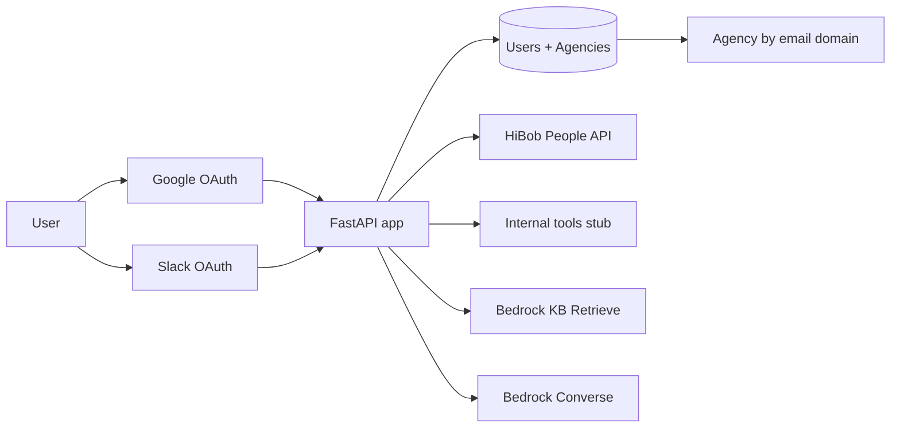

# MTPI User Profiles (PoC)

**Documentation:** [docs/README.md](./docs/README.md) — architecture, integrations, configuration, and operations.

Single sign-on hub that:

1. Authenticates users with **Google OAuth**
2. **Requires Slack** connection for profile enrichment
3. Enriches from **HiBob** (company directory) and a stub **internal tools** hook
4. Groups users into an **agency profile** by email domain
5. Retrieves **Bedrock Knowledge Base** chunks about the user (email, name, domain, role signals)
6. Generates an **LLM summary** (Amazon Bedrock via AWS profile `concrete`, with a local fallback)

Built with **FastAPI**; storage is **local JSON** by default or **DynamoDB** when you switch backends.

## Quick start (local JSON)

```bash
cd /Users/williamstaley/Sandbox/_mtpi_userprofiles
python3 -m venv .venv
source .venv/bin/activate
pip install -e .
cp .env.example .env
# Edit .env: APP_SECRET_KEY, GOOGLE_*, SLACK_*, optional HIBOB_*
uvicorn app.main:app --reload --port 8080
```

Open [http://127.0.0.1:8080](http://127.0.0.1:8080).

### Google OAuth

1. Create an OAuth client (Web application) in Google Cloud Console.
2. Authorized redirect URI: `http://127.0.0.1:8080/auth/google/callback`
3. Set `GOOGLE_CLIENT_ID` and `GOOGLE_CLIENT_SECRET` in `.env`.

### Slack OAuth

1. Create a Slack app at [api.slack.com](https://api.slack.com/apps).
2. Redirect URL: `http://127.0.0.1:8080/auth/slack/callback`
3. User token scopes: `users:read`, `users:read.email`, `users.profile:read`, `team:read`, `channels:read`
4. Set `SLACK_CLIENT_ID` and `SLACK_CLIENT_SECRET`.

After changing scopes, users must **connect Slack again** (sign out and re-authorize).

### Google People API (deeper profile)

1. In Google Cloud Console, enable **Google People API** for the same project as your OAuth client.
2. Re-sign in with Google (consent screen will request org/phone scopes).
3. Enrichment pulls organizations, bio, phones, and URLs into the profile and LLM context.

> **PoC note:** Slack user tokens are stored on the user record for simplicity. For production, encrypt tokens in Secrets Manager and store only references.

### HiBob

Create an [API service user](https://apidocs.hibob.com/docs/api-service-users.md) with People search permissions (root, about, employment, work categories). Set:

- `HIBOB_SERVICE_USER_ID`
- `HIBOB_SERVICE_USER_TOKEN`

The app calls `POST /v1/people/search` filtered by email ([read employee data guide](https://apidocs.hibob.com/docs/how-to-read-employee-data.md)).

## Bedrock Knowledge Base

When `BEDROCK_KNOWLEDGE_BASE_ID` is set, **Refresh enrichment** and **Generate LLM summary** call the Bedrock Agent Runtime [`Retrieve`](https://docs.aws.amazon.com/bedrock/latest/APIReference/API_agent-runtime_Retrieve.html) API with several queries derived from the user profile (email, name, domain, Slack/HiBob title hints).

**Bedrock Managed Knowledge Bases** require `managedSearchConfiguration` (default `BEDROCK_KB_SEARCH_MODE=managed`). Classic vector-store KBs use `BEDROCK_KB_SEARCH_MODE=vector`. Use `auto` to try managed first, then vector.

```env
AWS_PROFILE=concrete
AWS_REGION=us-east-1          # DynamoDB / general defaults
AWS_KB_REGION=us-east-1       # must match the region where the KB lives
BEDROCK_KNOWLEDGE_BASE_ID=XXXXXXXXXX
```

List knowledge bases in your account (use the same region as `AWS_KB_REGION`):

```bash
AWS_PROFILE=concrete aws bedrock-agent list-knowledge-bases --region "$AWS_KB_REGION"
```

IAM (minimum for the app user/role running locally):

- `bedrock:Retrieve` on the knowledge base
- `bedrock:InvokeModel` if you use Bedrock summaries

Results are stored on the user under `knowledge_base` and included in the LLM context (with source URIs when S3-backed).

## LinkedIn smart lookup (no username required)

On enrichment, the app:

1. Runs **web searches** biased toward `linkedin.com/in` (name, email domain, Slack title).
2. Collects candidate profile URLs from result snippets (search-index text only — no LinkedIn scraping).
3. Uses **Bedrock** to pick the best match and assign a **confidence** score.
4. If confidence ≥ `LINKEDIN_LOOKUP_MIN_CONFIDENCE` (default `0.72`), generates a short **summary** from snippets.

Configure search (Tavily recommended for production; DuckDuckGo is the zero-key fallback):

```env
TAVILY_API_KEY=tvly-...
WEB_SEARCH_PROVIDER=auto
LINKEDIN_LOOKUP_MIN_CONFIDENCE=0.72
```

Statuses: `ok`, `low_confidence` (candidates found but not promoted), `not_found`, `not_configured`.

## DynamoDB local (optional)

```bash
docker compose up -d dynamodb-local
AWS_PROFILE=concrete python scripts/init_dynamodb_tables.py
```

In `.env`:

```env
STORAGE_BACKEND=dynamodb
DYNAMODB_ENDPOINT=http://127.0.0.1:8000
AWS_PROFILE=concrete
```

## Architecture sketch



## API

- `GET /health` — liveness
- `GET /api/me` — JSON profile (requires session cookie after login)

## Next steps (ideas)

| Area | Idea |
|------|------|
| User profile | Normalize a canonical schema (`role`, `seniority`, `timezone`) from Google + Slack + HiBob with source precedence rules |
| Agency profile | Nightly job to roll up domains: headcount, common titles, Slack workspace IDs, HiBob sites |
| Internal tools | Replace `internal_tools.py` stub with your CRM / licensing APIs |
| Security | Move to Cognito hosted UI or keep Google and issue app sessions; never store Slack tokens in plain DynamoDB |
| AWS deploy | ECS/Fargate or Lambda + ALB; DynamoDB tables in `concrete`; Bedrock in-region |

## Project layout

- `app/main.py` — FastAPI entry
- `app/routers/auth.py` — Google + Slack OAuth
- `app/services/hibob.py` — HiBob People search
- `app/services/profile_builder.py` — enrichment orchestration
- `app/services/agency.py` — domain-based agency rollup
- `app/services/llm.py` — Bedrock summary + fallback
- `app/storage/` — local JSON or DynamoDB
