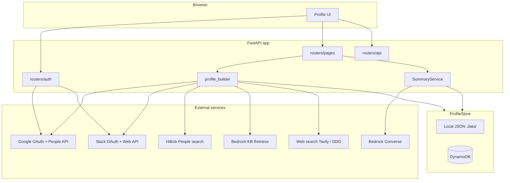

# Architecture

## High-level diagram

## Session model

- **Starlette `SessionMiddleware`** stores `user_id` (Google subject) in a signed cookie.
- **`require_user`** loads `UserProfile` from storage; unauthenticated requests get 401 on protected routes.

OAuth secrets (Google access/refresh, Slack user token) live **on the user record** under `google._oauth` and `slack._oauth`. They are **redacted** in `/api/me` via `redact.py`.

## Enrichment vs summary

| Action | Trigger | Work performed |
|--------|---------|----------------|
| **Refresh enrichment** | POST `/profile/refresh` | Full `refresh_user_profile` |
| **Generate summaries** | POST `/profile/summary` | Refresh user → user LLM → agency rollups + agency KB → agency LLM |

Details: [Enrichment pipeline](./enrichment-pipeline.md).

## LLM context

`enrichment_snapshot.build_llm_context()` builds a **compact, secret-free JSON** view for Bedrock user summaries. Agency summaries use `agency_context.build_agency_llm_context()` (all members + agency KB).

## Module responsibilities

| Module | Role |
|--------|------|
| `services/profile_builder.py` | Orchestrates enrichment |
| `services/google_enrichment.py` | People API + token refresh |
| `services/slack_enrichment.py` | Team, user, public channels |
| `services/hibob.py` | People search by email |
| `services/bedrock_knowledge_base.py` | User + agency Retrieve |
| `services/linkedin_lookup.py` | Search, disambiguate, summarize |
| `services/llm.py` | User + agency Converse summaries |
| `services/agency.py` | Domain agency membership + rollups |
| `services/agency_enrichment.py` | Agency KB + rollups before agency summary |

## Storage abstraction

`ProfileStore` interface: get/save user and agency. Factory selects implementation from `STORAGE_BACKEND`:

- `local` → one JSON file per user/agency under `LOCAL_DATA_DIR`
- `dynamodb` → tables with `user_id` / `agency_id` keys; users table has GSI `email-index`

## Related

- [Data model & storage](./data-model-and-storage.md)
- [Configuration reference](./configuration.md)
