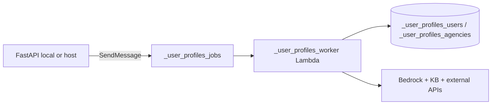

# AWS Lambda offload (`_user_profiles`)

Heavy work (**Refresh enrichment**, **Generate summaries**) can run in AWS instead of the FastAPI process.

## Architecture



## Enable in `.env`

After deploy (see below):

```env
_USER_PROFILES_OFFLOAD=true
_USER_PROFILES_JOBS_QUEUE_URL=https://sqs....
_USER_PROFILES_WORKER_FUNCTION_NAME=_user_profiles_worker
STORAGE_BACKEND=dynamodb
DYNAMODB_ENDPOINT=
DYNAMODB_USERS_TABLE=_user_profiles_users
DYNAMODB_AGENCIES_TABLE=_user_profiles_agencies
AWS_PROFILE=concrete
```

When `_USER_PROFILES_OFFLOAD=false`, jobs run **in-process** (original behavior).

With `_USER_PROFILES_OFFLOAD=true`, **enrich** is queued to SQS/Lambda. By default **`_USER_PROFILES_OFFLOAD_SUMMARIZE=false`**, so **Analyze role & generate summaries** still runs in the web app (waits for `work_profile` before redirect). Set `_USER_PROFILES_OFFLOAD_SUMMARIZE=true` only if you want summarize on Lambda too.

## Deploy (profile `concrete`)

1. Create an S3 bucket for Lambda artifacts (once).
2. Set in `.env`:

```env
_USER_PROFILES_ARTIFACT_BUCKET=your-artifacts-bucket
AWS_PROFILE=concrete
AWS_REGION=us-east-1
# ... all integration secrets used by enrichment
```

3. Use an **S3 artifact bucket in the same region as Lambda** (e.g. `us-east-1`). CloudFormation stack name must start with a letter (`user-profiles-stack`).

4. Run:

```bash
chmod +x scripts/_user_profiles_deploy.sh scripts/_user_profiles_build_lambda.sh
./scripts/_user_profiles_deploy.sh
```

The script sources `.env`, uploads the zip, deploys `infra/_user_profiles_stack.yaml`, and syncs Lambda environment variables from `.env` via `scripts/_user_profiles_lambda_env.py`.

5. Copy printed queue URL into `_USER_PROFILES_JOBS_QUEUE_URL`, set `STORAGE_BACKEND=dynamodb`, clear `DYNAMODB_ENDPOINT`, and restart uvicorn.

## IAM for developers

Your `concrete` IAM user/role needs **`sqs:SendMessage`** on `_user_profiles_jobs` to enqueue from the web app.

## Job status

`UserProfile.processing_status` tracks `queued` → `running` → `completed` | `failed` (shown on the profile page).

## Related

- [AWS & production notes](./aws-and-production-notes.md)
- [Enrichment pipeline](./enrichment-pipeline.md)
