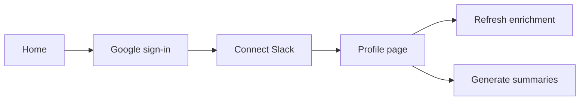

# Overview

## Purpose

MTPI User Profiles is an internal **identity and work-understanding hub** for the **Meet The People** agency network. After a user signs in, the system:

1. Persists a **user record** (keyed by Google subject ID).
2. Pulls data from **Slack**, optional **HiBob**, **Google People API**, **Bedrock Knowledge Base**, and **web search** (LinkedIn discovery).
3. Groups users into an **agency** by **email domain** (e.g. `radar-analytics.com`).
4. Builds a structured **`work_profile`** — function, seniority, day-to-day focus, and **suggested workflow IDs** for routing in other MTP platforms.
5. Generates **role-focused LLM briefs** for the person and their agency using Amazon Bedrock.

The target deployment is **AWS** (DynamoDB, Bedrock), but the default developer experience is **local** (JSON files under `.data/`, optional DynamoDB Local).

## User journey

- **Google** is required to enter the app.
- **Slack** is required before the profile page (user token for enrichment).
- **Refresh enrichment** re-runs all configured integrations.
- **Analyze role & generate summaries** refreshes enrichment, infers `work_profile`, then writes Bedrock (or fallback) markdown for both user and agency.

## Two profile layers

| Layer | Key | What it represents |
|-------|-----|-------------------|
| **User** | Google `sub` | One person: OAuth identity + enriched blobs per source |
| **Agency** | Email domain | Organization inferred from users sharing the same domain |

Agency records **accumulate** as more users from the same domain sign in (member list, rollups, KB search, agency summary).

## Out of scope (PoC)

- Production-grade secret storage (Slack/Google tokens on disk).
- LinkedIn scraping (only search snippets + LLM inference).
- Private Slack channels or message history.
- Admin UI or multi-tenant RBAC.

See [AWS & production notes](./aws-and-production-notes.md) for hardening direction.

## Related

- [Work profile & workflow routing](./work-profile.md)
- [Architecture](./architecture.md)
- [Enrichment pipeline](./enrichment-pipeline.md)
- [LLM summaries](./llm-summaries.md)
